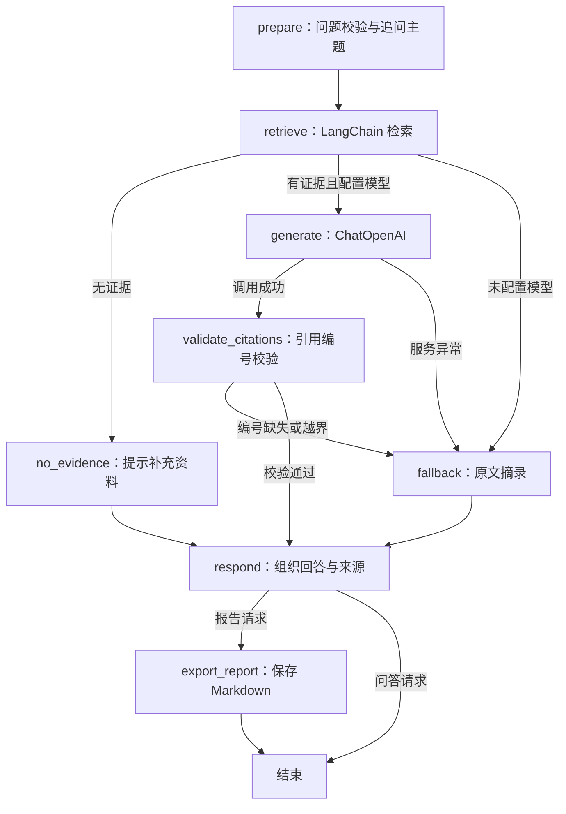

# LangChain + LangGraph 架构

HTTP 路由和网页接口保持兼容，`PowerAgent.run()`、`PowerAgent.daily_chat()` 现在调用编译后的 LangGraph 图。图在实例创建时编译，每次请求创建独立状态；不使用共享会话状态或 checkpoint。

## 职责

| 文件 | 职责 |
| --- | --- |
| `power_agent/model.py` | LangChain `ChatOpenAI` 连接 302.AI，处理文字 / 图片消息、输出长度和服务响应 |
| `power_agent/retriever.py` | LangChain `BaseRetriever` 将数据库检索结果转换成 `Document`，保留标题、行号、来源编号等元数据 |
| `power_agent/workflows.py` | LangGraph `StateGraph` 状态、节点、条件路由和编译 |
| `power_agent/agent.py` | 提示词、配置、聊天输入校验、错误提示、Markdown 导出及调用图的兼容入口 |
| `power_agent/postgres.py` | PostgreSQL 文档及分块存储，pgvector + 全文检索，事务与索引 |
| `power_agent/embeddings.py` | LangChain OpenAIEmbeddings，经 302.AI 生成 1536 维向量 |
| `power_agent/knowledge.py` | 通用分块与中文分词，SQLite 兼容实现 |

## 知识问答和报告



引用校验仅验证编号存在，不判定每条陈述的正确性。模型生成失败或引用无效时，报告节点只收到本地摘录，不导出未经校验的模型正文。页面中的执行步骤由实际经过的节点产生。

## 智能助手与长期记忆

默认入口为智能助手，`power_agent/assistant.py` 编译独立 LangGraph：

```text
load_context → plan → [retrieve 或跳过] → answer → persist → END
             ↘ recall ────────────────────────↗
```

- `load_context` 从数据库读取本会话最近 10 轮、滚动摘要与启用的全局长期记忆；模型历史文本限制为 20000 字符，每条历史回复最多 4000 字符，并限制上下文图片数量和大小。
- `recall` 处理明确的本会话第一条、第 N 条或上一条消息查询，按 session_id 和 ordinal 直接读取原始用户记录，不调用模型或知识库，避免窗口截断和旧回复错误影响结果。计数依据用户消息顺序；图片消息也计入。该功能在关闭长期记忆时仍可用，不查其他会话。
- `plan` 通过 LangChain 调用模型，参考资料目录及上下文输出检索判断、独立检索问题、更新摘要和记忆候选。无效输出会安全降级为保守路由，不保存记忆候选。
- `retrieve` 使用已有 LangChain Retriever / PostgreSQL+pgvector 混合检索；普通闲聊可跳过。模型只为本轮真正引用的资料显示来源，无引用的知识性回答标明为通用解释。
- `answer` 组织自然回答；统一英文/中文引用括号，不存在的引用编号或已识别的功率因数常见概念混淆会修正一次；仍无效则返回错误且不保存轮次。该检查不等于全面事实验证。
- 资料、摘要、记忆及单独读取的首条消息通过标注为不可信参考数据的 system 消息提供，不伪装成用户发言；user 角色仅包含真实聊天消息。身份和明确的聊天回顾问题跳过知识库路由；一般回顾仍受近期窗口和摘要限制，不能保证任意旧细节都在模型上下文中。
- `persist` 用一个事务保存用户消息、图片、助手回复（含引用）、摘要及已验证的长期记忆候选。记忆只能逐字摘自当前用户消息，不来自文档或助手输出。上限 50 条，网页允许编辑/删除和开关。

`power_agent/conversations.py` 使用知识库同一数据库/schema，新增 `conversations`、`conversation_turns`、`user_memories` 表。单用户工作空间中记忆跨会话共享；会话上下文按 session_id 隔离。成功请求按 request_id 幂等；模型失败无数据库副作用。内存锁串行化同一应用中的聊天和记忆修改，数据库事务保证原子性。持久化不依赖 LangGraph checkpointer：恢复到已完成的对话轮次，不恢复半途节点。

HTTP 接口：`POST /api/assistant`；`GET/POST /api/conversations`；`GET/DELETE /api/conversations/:id`（GET 可带 before 加载更早轮次）；`GET/POST/DELETE /api/memories`；`DELETE /api/memories/:id`。写操作沿用 CSRF 和本机来源校验。旧 `/api/daily-chat` 保留为无持久化兼容接口，网页不再使用它。图片仍使用 Chat Completions image_url 内容块，现在随成功会话保存在数据库。

`POST /api/assistant/cancel` 用 session_id + request_id 取消智能助手本轮请求。取消令牌中断本地等待并关闭已注册的模型/向量 HTTP 客户端；迟到结果不能继续图节点或提交。取消与 persist 共享互斥锁，已提交时返回 completed，否则返回 cancelled；处理取消先于生成请求到达的竞态。取消记录仅在当前进程内保留，最多 256 条，清理 10 分钟前记录。外部调用在线程中运行，不能强制终止远端计算；本地立即放弃结果，剩余调用受网络超时约束。该接口不暂停已提交轮次，也不提供续传。

## 配置与扩展

- `.env` 沿用现有配置。完整的 `/v1/chat/completions` 地址自动转换成 `ChatOpenAI` 所需的 `/v1` 基础地址，不重复拼接路径。
- 固定使用 Chat Completions；超时 45 秒、不自动重试、不跟随重定向。密钥只在后端读取。
- 两个应用入口和模型适配器均关闭 LangSmith tracing，不因外部追踪环境变量上传图状态或资料。
- 已启用 PostgreSQL + pgvector 混合检索，详见 [数据库说明](postgres.md)。智能助手支持模型选择是否检索和长期记忆；尚未提供任意工具执行或实时网络检索。
- 可通过 `agent.knowledge_graph.get_graph().draw_mermaid()` 或 `agent.chat_graph.get_graph().draw_mermaid()` 导出真实节点图的 Mermaid 文本；无需远程渲染服务。

依赖版本在 `requirements.txt`，完整解析结果在 `requirements-lock.txt`。已有 SQLite 资料通过 `migrate_postgres.py` 迁移并保留 ID；已生成的报告无需迁移。启动时使用项目 `.venv` 解释器；普通单元测试通过 HTTP MockTransport 验证真实 LangChain / SDK 序列化，不调用付费服务。

参考：[LangGraph Graph API](https://docs.langchain.com/oss/python/langgraph/graph-api)、[LangChain ChatOpenAI](https://docs.langchain.com/oss/python/integrations/chat/openai)。

## 外网多用户空间

power_agent/accounts.py 管理 PostgreSQL 账号、独立盐密码摘要、账号版本及权限。ShareAccess 登录后将服务端验证的用户身份和会话 CSRF 绑定至请求，WorkspaceManager 仅以服务端账号 ID 分派私有 schema 和报告目录，不接受请求中的 owner 或 schema。UserKnowledge 只合并当前私库与获准读取的公共库，重新编号引用；公共增删要求管理员。每个用户有独立助手实例与生成锁。已有本机工作空间保持不变，旧共享聊天不自动归属任何新账号。详见 sharing.md 的权限矩阵和边界。
